# Assignment 5. JavaScript Basics (DOM Manipulation & Events)

**Name:** Tamerlan Aitken
**Group:** IT-2503

**GitHub repository:** https://github.com/YOUR_USERNAME/assignment5
**GitHub Pages:** https://YOUR_USERNAME.github.io/assignment5/

## Project files

- `index.html` - page structure (profile, calculations, form, list)
- `style.css` - simple styles for the page
- `script.js` - all JavaScript code for the tasks
- `screenshots/` - screenshots for the report

How to run: open `index.html` in a browser or open the GitHub Pages link. To see console output press F12 and open the Console tab.

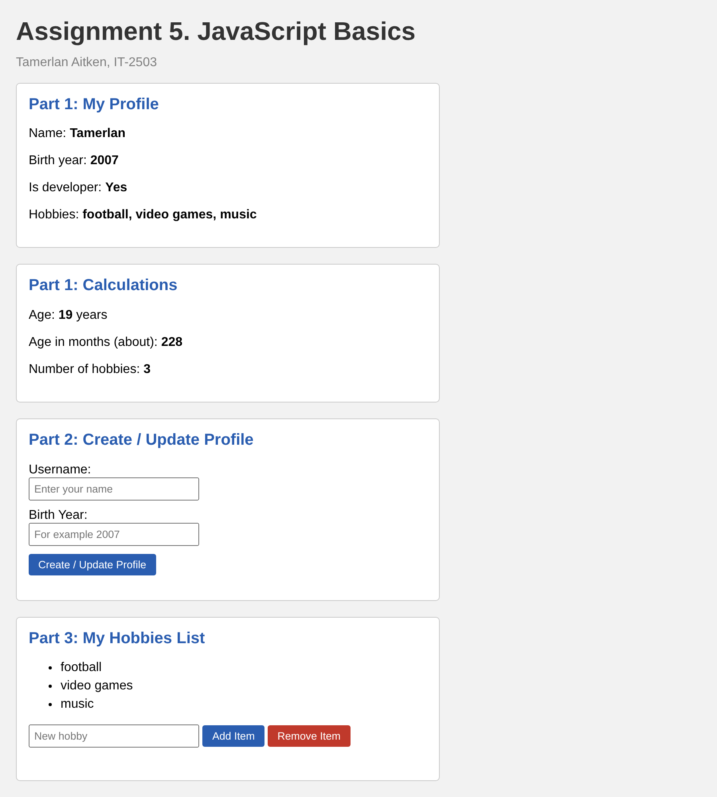

---

## Part 1: Profile Object, Data Types & Arithmetic

### Task 1. The Personal Info Object

Create a JavaScript const object named `userProfile` that stores various data types: string (name), number (birthYear), boolean (isDeveloper), an array (hobbies).

I created a const object `userProfile` with 4 properties of different types. I also print the object and the type of every property to the console using `typeof` and `Array.isArray()`.

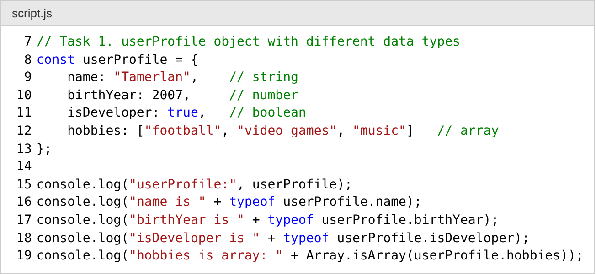

Result on the page:

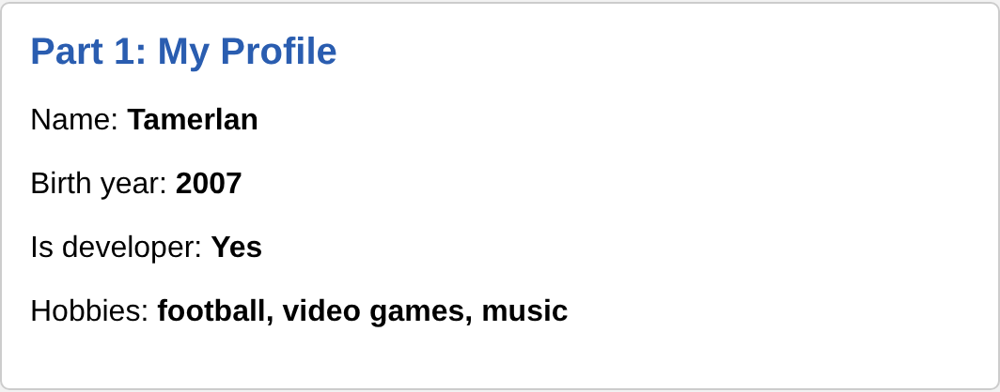

Console output:

```
userProfile: {name: 'Tamerlan', birthYear: 2007, isDeveloper: true, hobbies: Array(3)}
name is string
birthYear is number
isDeveloper is boolean
hobbies is array: true
```

### Task 2. Arithmetic Calculations

Write a script that uses arithmetic operators to calculate the user's current age dynamically (current year minus birthYear). Calculate another metric, such as how many months old they are or total hobbies count, and display these values in the console or on the page.

- Age = current year (`new Date().getFullYear()`) - birthYear
- Months = age * 12
- Hobbies count = `hobbies.length`

The values are shown on the page and in the console. The function `showProfile()` is called again every time the profile or the list changes, so the numbers always update.

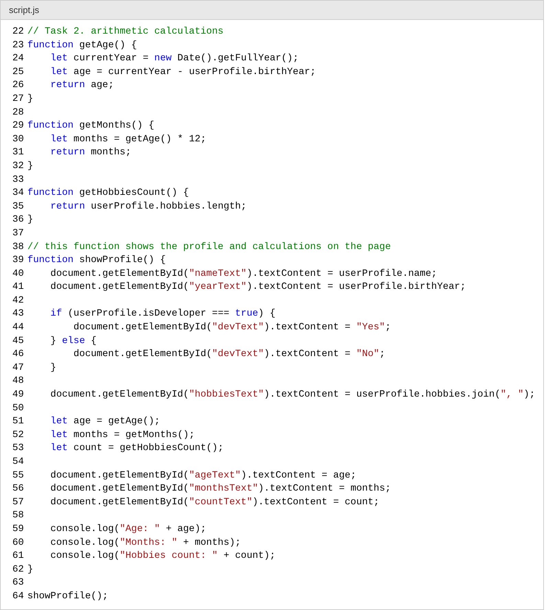

Result on the page:

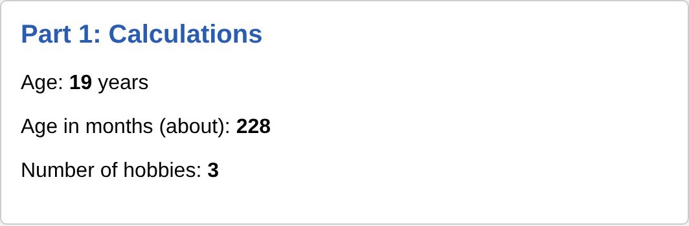

Console output:

```
Age: 19
Months: 228
Hobbies count: 3
```

---

## Part 2: Form Input & Event Responses

### Task 3. HTML Form Setup

Create a simple form containing an input for Username, an input for Birth Year and a "Create / Update Profile" submit button.

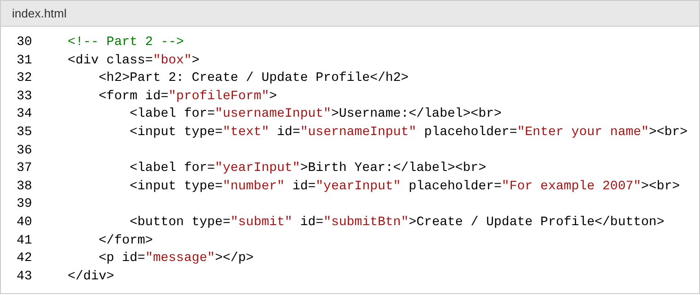


### Task 4. Event Listener

Add a click or submit event listener to the button. When clicked, capture the user's input values and update your userProfile object.

I added a `submit` event listener to the form. `event.preventDefault()` stops the page from reloading. Then the script takes the values from the inputs, checks them, updates `userProfile.name` and `userProfile.birthYear` and calls `showProfile()` again. The message changes color (red for error, green for success) and the profile box background becomes green after update.

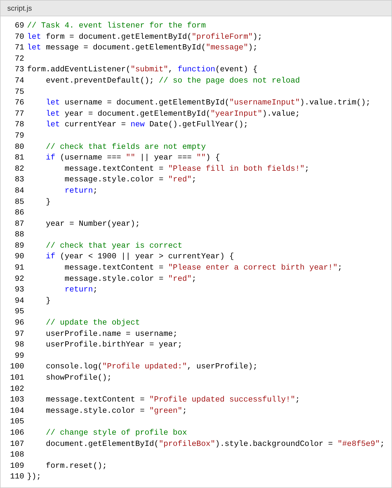

If the fields are empty an error message is shown:

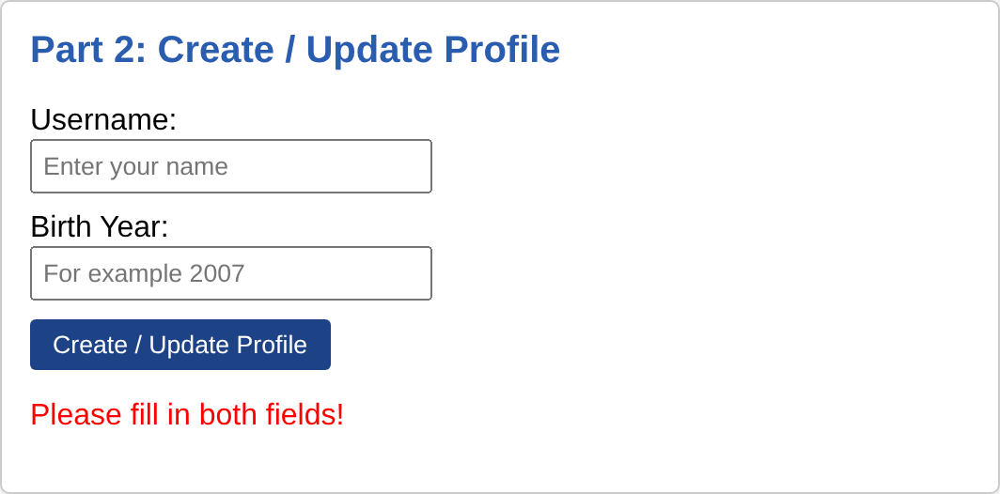

After entering "Tamerlan Aitken" and 2006 and clicking the button, the profile and age are updated:

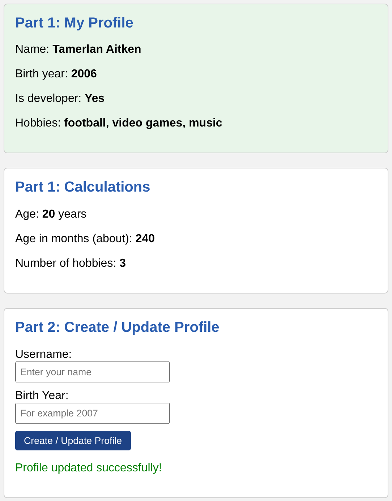

Console output after update:

```
Profile updated: {name: 'Tamerlan Aitken', birthYear: 2006, isDeveloper: true, hobbies: Array(3)}
Age: 20
Months: 240
Hobbies count: 3
```

---

## Part 3: DOM List Manipulation

### Task 5. Creating & Removing Elements

Create an unordered list (`<ul>`) representing your tasks or hobbies. Create an "Add Item" button that lets the user input and add a new `<li>` item to the list. Create a "Remove Item" button that deletes the last item from the list.

At the start the list is filled with hobbies from the `userProfile` object using a for loop. "Add Item" creates a new `<li>` with `document.createElement()` and adds it with `appendChild()`. "Remove Item" finds the last `<li>` with `lastElementChild` and deletes it with `removeChild()`. The hobbies array in the object is also updated with `push()` and `pop()`, so the hobbies count changes too.

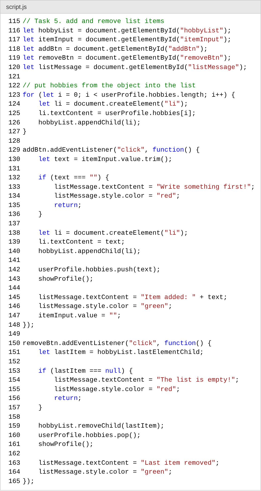

After adding "reading books":

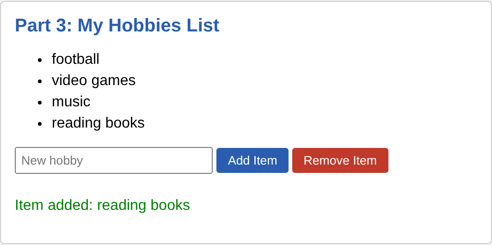

After clicking "Remove Item" two times:

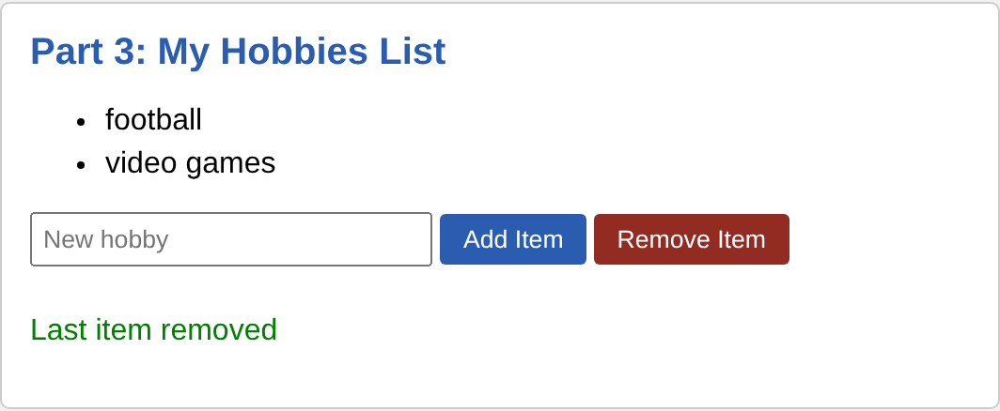

---

## Summary

First I made the HTML page with 4 blocks: profile, calculations, form and hobbies list, and added simple CSS. Then I wrote the `userProfile` object and functions for age, months and hobbies count, and the `showProfile()` function that puts all values on the page with `getElementById()` and `textContent`. After that I added a submit event listener to the form that reads the inputs, checks them and updates the object. In the last part I made the list where items can be added and removed with `createElement()`, `appendChild()` and `removeChild()`.

In this assignment I learned how to work with objects and data types, use arithmetic operators, get elements from the DOM, change their text and styles, and react to user actions with event listeners. I also learned that a `const` object can still be changed (its properties), only the variable itself cannot be reassigned.
